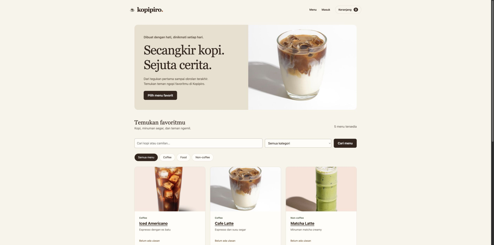
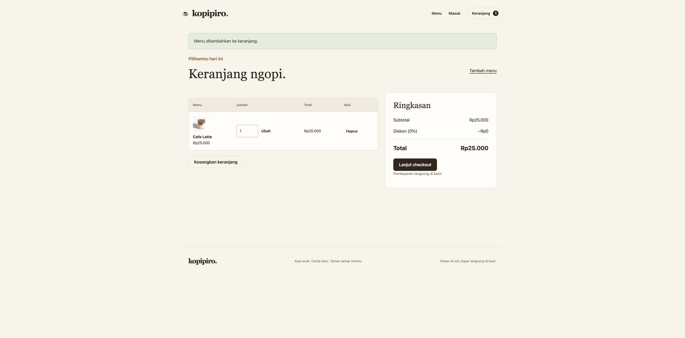
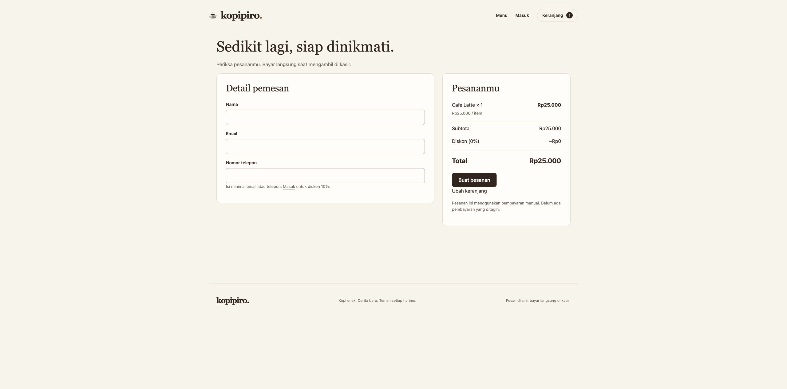
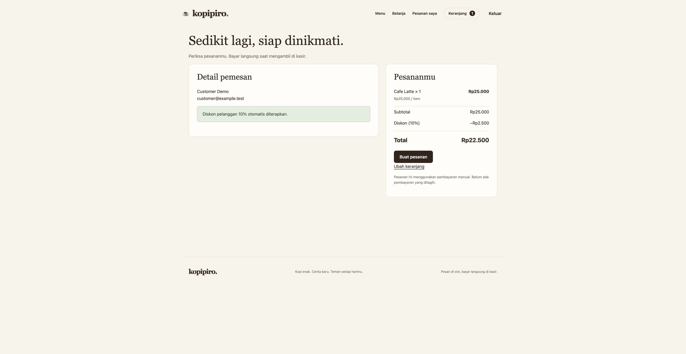
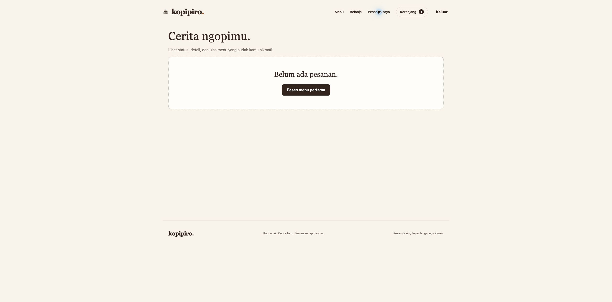
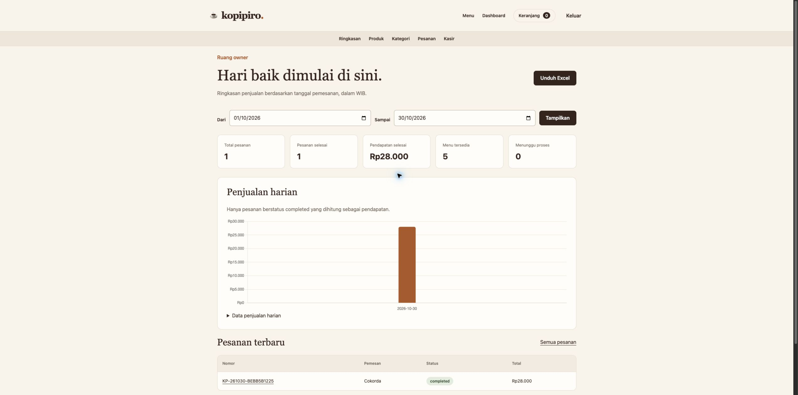
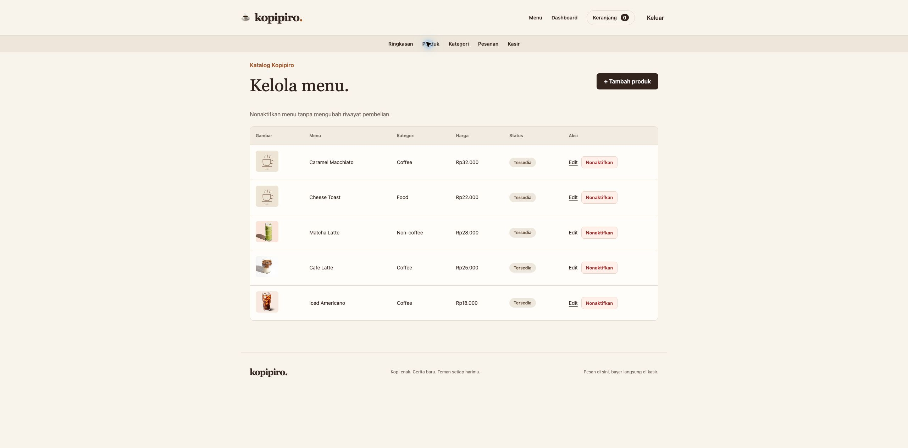
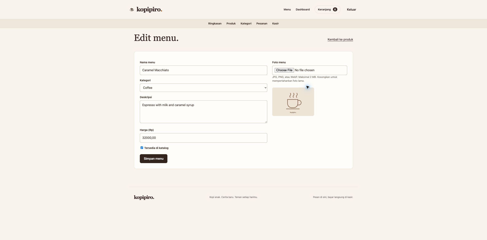
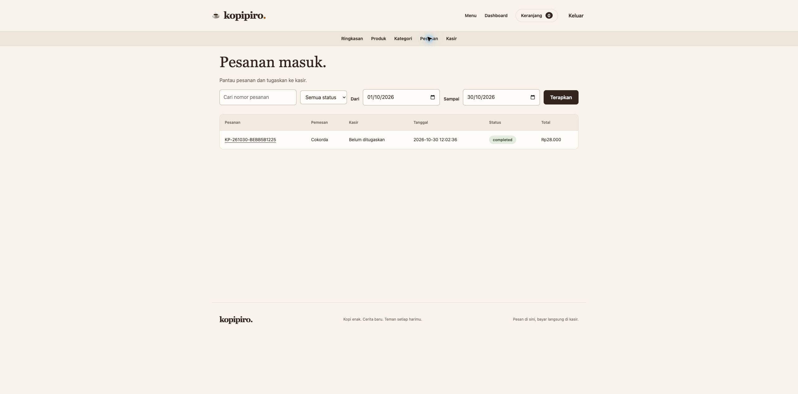
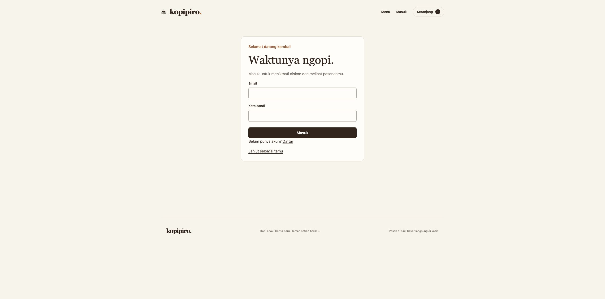

# Kopipiro

**Aplikasi pemesanan dan pengelolaan kedai kopi.**

Kopipiro membantu pengunjung memilih menu, membuat pesanan, dan mengikuti prosesnya sampai selesai. Owner mengelola katalog dan penjualan, sedangkan kasir memproses pesanan yang ditugaskan kepadanya.

Proyek studi kasus individu **Pemrograman Web — Minggu 9–10**, menggunakan PHP Native dan MySQL.

> Pelanggan yang sudah login mendapat **diskon 10%**. Tamu tetap bisa memesan dengan harga normal. Pembayaran dilakukan langsung di kasir.

[**Panduan penggunaan**](#panduan-penggunaan) · [**Instalasi**](#instalasi-lokal) · [**Akun admin**](#akun-admin-dan-customer) · [**Pengujian**](#pengujian) · [**Dokumentasi teknis**](docs/TECHNICAL.md)

## Fitur utama

| Pengguna | Yang bisa dilakukan |
| --- | --- |
| **Tamu / belum login** | Melihat menu, mencari dan memfilter produk, mengisi keranjang, checkout tanpa registrasi. |
| **Customer / sudah login** | Mendapat diskon 10%, melihat pesanan sendiri, memberi rating dan ulasan setelah pesanan selesai. |
| **Kasir** | Melihat detail dan memproses status pesanan yang ditugaskan owner. |
| **Admin / owner** | Mengelola produk, foto, kategori, akun kasir, penugasan pesanan, dashboard penjualan, dan ekspor Excel. |

## Panduan penggunaan

Screenshot berikut diambil langsung dari aplikasi lokal pada **30 Oktober 2026**. Isi katalog, angka dashboard, dan status pesanan mengikuti data pada saat pengambilan gambar. Identitas pada screenshot checkout memakai akun contoh agar email pribadi tidak dipublikasikan. Klik gambar untuk melihatnya lebih besar.

### 1. Customer yang belum login

Pengunjung langsung disambut katalog menu. Tidak perlu membuat akun untuk mulai berbelanja.

1. Pilih kategori atau ketik nama menu pada kolom pencarian.
2. Klik **+ Tambah**, lalu buka **Keranjang** untuk mengubah jumlah atau menghapus menu.
3. Klik **Lanjut checkout**. Isi nama dan minimal salah satu kontak: email atau telepon.
4. Periksa total, lalu klik **Buat pesanan**. Simpan nomor konfirmasi dan bayar langsung di kasir.

[](docs/screenshots/guest-catalog.jpg)

<details>
<summary><strong>Lihat keranjang dan checkout tamu</strong></summary>

**Keranjang.** Jumlah menu dapat diubah sebelum checkout.

[](docs/screenshots/guest-cart.jpg)

**Checkout tanpa login.** Pada contoh ini, satu Cafe Latte berharga Rp25.000, tanpa diskon.

[](docs/screenshots/guest-checkout.jpg)

</details>

### 2. Customer yang sudah login

Buka **Masuk**, lalu gunakan akun customer. Jika belum memiliki akun, pilih **Daftar** terlebih dahulu.

1. Tambahkan menu ke keranjang seperti biasa.
2. Di checkout, nama dan email diambil dari akun. **Diskon 10% diterapkan otomatis.**
3. Setelah membuat pesanan, buka **Pesanan saya** untuk melihat status dan detailnya.
4. Setelah status **completed**, buka detail produk dari pesanan untuk menulis ulasan.

Contoh perbandingan untuk menu yang sama:

| Rincian | Tamu | Customer login |
| --- | ---: | ---: |
| Cafe Latte × 1 | Rp25.000 | Rp25.000 |
| Diskon | Rp0 | Rp2.500 |
| **Total** | **Rp25.000** | **Rp22.500** |

[](docs/screenshots/customer-checkout.jpg)

<details>
<summary><strong>Lihat katalog setelah login dan halaman pesanan saya</strong></summary>

**Katalog setelah login.** Navigasi menyediakan **Pesanan saya** dan **Keluar**.

[](docs/screenshots/customer-catalog.jpg)

**Pesanan saya.** Hanya pesanan milik akun tersebut yang ditampilkan. Pada saat screenshot ini diambil, akun customer belum memiliki pesanan sehingga muncul petunjuk untuk membuat pesanan pertama.

[](docs/screenshots/customer-orders.jpg)

</details>

### 3. Admin dan dashboard

Admin menggunakan role **owner**. Setelah login, akun ini langsung diarahkan ke dashboard.

Dashboard menampilkan total pesanan, jumlah pesanan selesai, pendapatan, menu tersedia, dan pesanan yang menunggu proses. Pilih tanggal **Dari** dan **Sampai**, lalu klik **Tampilkan** untuk mengganti periode laporan.

**Pendapatan dan grafik hanya menghitung pesanan completed.** Tombol **Unduh Excel** menghasilkan laporan XLSX sesuai rentang tanggal.

[](docs/screenshots/admin-dashboard.jpg)

<details>
<summary><strong>Lihat pengelolaan produk, form edit, dan daftar pesanan</strong></summary>

**Produk.** Klik **+ Tambah produk** untuk menu baru, **Edit** untuk memperbarui, atau **Nonaktifkan** untuk menyembunyikan menu dari katalog. Riwayat pesanan tetap tersimpan.

[](docs/screenshots/admin-products.jpg)

**Edit menu.** Owner dapat mengganti nama, kategori, deskripsi, harga, foto, dan ketersediaan. Kosongkan upload foto jika ingin mempertahankan gambar lama, lalu klik **Simpan menu**.

[](docs/screenshots/admin-product-edit.jpg)

**Pesanan.** Cari berdasarkan nomor, status, atau tanggal. Buka nomor pesanan untuk melihat item dan menugaskan kasir pada pesanan yang masih berjalan.

[](docs/screenshots/admin-orders.jpg)

</details>

### 4. Alur pemrosesan oleh kasir

**Checkout → owner menugaskan kasir → pending → processing → ready → completed**

- Kasir hanya melihat dan memproses pesanan yang ditugaskan kepadanya.
- Owner dapat menugaskan ulang atau membatalkan pesanan yang masih berjalan.
- Pesanan **completed** atau **cancelled** tidak dapat dibuka kembali.
- Aplikasi menggunakan pembayaran manual; konfirmasi order bukan bukti pembayaran online.

## Instalasi lokal

### Persiapan

| Kebutuhan | Versi / keterangan |
| --- | --- |
| PHP | 8.2 atau lebih baru; tersedia melalui XAMPP atau MAMP. |
| Database | MySQL / MariaDB dengan InnoDB dan charset `utf8mb4`. |
| Composer | Menginstal PhpSpreadsheet untuk ekspor XLSX. |
| Ekstensi PHP | `pdo_mysql`, `fileinfo`, `mbstring`, `gd`, `zip`, `xml`, `dom`, `xmlreader`, `xmlwriter`. |

### Langkah instalasi

1. Salin proyek ke folder `htdocs/pweb-casestudy1` dan aktifkan **Apache** serta **MySQL**.
2. Buat database **kopipiro** melalui phpMyAdmin.
3. Import **database/schema.sql** ke database tersebut.
4. Buka terminal pada folder proyek dan jalankan:

   ```sh
   composer install --no-interaction --prefer-dist
   ```

5. Untuk database baru yang masih kosong, isi lima menu contoh awal:

   ```sh
   php database/seed_catalog.php
   ```

   Script ini menolak menimpa katalog yang sudah berisi data. Lewati langkah ini jika produk sudah tersedia.

6. Buat akun owner melalui [panduan akun admin](#akun-admin-dan-customer), kemudian buka [aplikasi lokal](http://localhost/pweb-casestudy1/).

> **Sudah punya database dari versi sebelumnya?** Backup terlebih dahulu, lalu jalankan `php database/migrate.php` atau import `database/upgrade.sql`. Migrasi menambahkan tabel yang diperlukan tanpa menghapus produk dan kategori lama.

<details>
<summary><strong>PHP XAMPP tidak terbaca di Terminal macOS?</strong></summary>

Tambahkan executable XAMPP ke PATH untuk sesi terminal tersebut:

```sh
export PATH="/Applications/XAMPP/xamppfiles/bin:$PATH"
php -v
```

Pada mesin ini, folder proyek berada di `/Applications/XAMPP/xamppfiles/htdocs/pweb-casestudy1`.

</details>

Konfigurasi lokal awal menggunakan host `localhost`, database `kopipiro`, user `root`, dan password database kosong mengikuti instalasi awal XAMPP. Pengaturan lain, termasuk port MAMP, environment Apache, dan migrasi, dijelaskan pada [dokumentasi teknis](docs/TECHNICAL.md#konfigurasi-lanjutan).

## Akun admin dan customer

**Semua role memakai halaman login yang sama.** Aplikasi menentukan halaman tujuan berdasarkan role akun, bukan berdasarkan pilihan pada form.

| Akun | Cara membuat | Halaman setelah login |
| --- | --- | --- |
| Customer | Tombol **Daftar** di halaman login. | Katalog dan **Pesanan saya**. |
| Admin / owner | Seeder CLI berikut, dijalankan sekali. | Dashboard owner. |
| Kasir | Menu **Kasir** milik owner, atau seeder CLI. | Daftar pesanan yang ditugaskan. |

Tidak ada password admin bawaan di repository. Gunakan email dan password yang kamu tentukan sendiri.

### Membuat akun owner

Buka terminal di folder proyek. **Jalankan setiap langkah secara terpisah**, terutama saat diminta mengetik password.

**1. Tentukan email dan nama akun.** Ganti contoh ini sesuai kebutuhan.

```sh
export SEED_EMAIL="owner@example.test"
export SEED_NAME="Owner Kopipiro"
```

**2. Jalankan perintah ini, ketik password 12–72 byte, lalu tekan Enter.** Karakter password memang tidak terlihat saat diketik. Jangan langsung mempaste perintah langkah berikutnya.

```sh
read -s SEED_PASSWORD
```

**3. Setelah kembali ke prompt terminal, buat akun.**

```sh
SEED_PASSWORD="$SEED_PASSWORD" php database/seed.php owner
```

Pesan **Local owner created** menandakan akun berhasil dibuat. Gunakan email dan password tadi pada halaman **Masuk**.

**4. Bersihkan variabel setelah selesai.**

```sh
unset SEED_EMAIL SEED_NAME SEED_PASSWORD
```

Untuk membuat akun kasir lewat CLI, gunakan langkah yang sama dengan `php database/seed.php cashier` pada langkah ketiga. Email yang sudah terdaftar tidak akan ditimpa atau diubah rolenya.

<details>
<summary><strong>Lihat halaman login</strong></summary>

[](docs/screenshots/login.jpg)

</details>

## Struktur dan cara membaca kode

```text
pweb-casestudy1/
├── admin/          Dashboard, produk, kategori, kasir, pesanan, ekspor
├── auth/           Register, login, logout
├── cart/           Keranjang dan aksi tambah/ubah/hapus
├── cashier/        Daftar pesanan dan proses status oleh kasir
├── customer/       Riwayat pesanan dan ulasan
├── includes/       Session, helper, aturan bisnis, header/footer
├── config/         Koneksi PDO
├── database/       Schema, migrasi, inisialisasi akun dan katalog
├── assets/         CSS, JavaScript, Chart.js, gambar bawaan
├── uploads/        Foto produk hasil upload
├── docs/           Dokumentasi teknis, screenshot, hasil verifikasi
├── tests/          Unit test dan pengujian HTTP/PDO
├── checkout.php    Validasi dan penyimpanan pesanan
└── index.php       Katalog utama
```

Mulai dari `index.php`, lalu ikuti alurnya ke `cart/add.php`, `cart/index.php`, dan `checkout.php`. Perhitungan harga/diskon berada di `includes/domain.php`; login, query, dan pemeriksaan akses dibantu `includes/bootstrap.php`.

Penjelasan tabel database, CRUD/PDO, upload, CSRF, transaksi checkout, dan ekspor tersedia di [dokumentasi teknis](docs/TECHNICAL.md).
