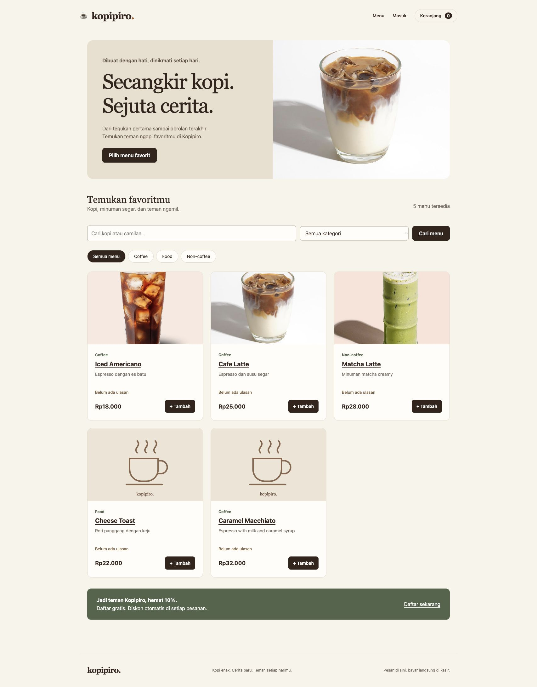

# Hasil verifikasi Kopipiro

Tanggal: 29 Oktober 2026 (Asia/Jakarta). Runtime: XAMPP PHP 8.2.4, MariaDB, Apache lokal; Composer dengan PhpSpreadsheet 5.10.0. Seluruh perubahan masih uncommitted.

## Hasil aktual

| Pemeriksaan | Hasil |
| --- | --- |
| Syntax lint seluruh PHP aplikasi/test (vendor dikecualikan) | 43 file, lulus |
| `php tests/unit.php` | 13 pemeriksaan bernama + kasus jumlah invalid, lulus |
| `python3 tests/run.py` | 86 assertion HTTP/PDO, lulus |
| Composer validate --strict | Lulus |
| Composer check-platform-reqs | Seluruh ekstensi/runtime terpenuhi |
| Composer audit | Advisories kosong; abandoned kosong (retry pertama timeout jaringan) |
| `git diff --check` | Lulus |
| Koneksi PDO, query MySQL, schema fresh dan migrasi ulang | Lulus |
| Backup vs baris INSERT katalog setelah migrasi | Identik: 5 produk, 3 kategori |
| Database utama setelah tes | 0 users, 0 orders; tidak ada fixture demo |
| Apache config/database/includes/tests access | 403; metadata `.git` 404 |
| Chrome desktop | Katalog, semua gambar, navigasi, dashboard dan grafik terlihat |
| Chrome mobile 390×844 | Katalog, cart, checkout dan dashboard diuji; tidak ada horizontal overflow dokumen |
| Independen code review | Dua P2 direproduksi dan diperbaiki; pemeriksaan koreksi tidak menemukan defect penting lain |

## Bukti cakupan otomatis

- Guest/role guards, POST-only, CSRF kosong/palsu, register tidak bisa menaikkan role, hash password, email duplikat, password salah, session ID berubah setelah login, logout.
- Multi-item checkout guest Rp70.000 tanpa diskon dan customer Rp70.000 − Rp7.000 = Rp63.000; forged totals tidak dipercaya.
- Repeat checkout POST dan refresh tidak menggandakan order. Tebakan ID/token guest gagal, customer lain tidak bisa melihat riwayat/detail.
- Trigger database test memaksa item kedua gagal setelah order dan item pertama disisipkan: semuanya rollback; cart tetap berisi semua item.
- Kasir B tidak dapat melihat/memodifikasi order Kasir A lewat URL/POST. Self-assignment, skip status, pembatalan kasir, reassign atau cancel completed ditolak; forward workflow lulus.
- Pembelian belum selesai tidak boleh review. Rating invalid ditolak; edit ulasan tetap satu baris; komentar HTML di-escape dan average rating tampil dari database.
- Product CRUD, foto PNG/JPEG/WebP, nama acak dengan extension sesuai konten, MIME palsu/ukuran lebih dari 2 MB ditolak. Replace membersihkan foto lama; tidak upload mempertahankan foto; trigger DB failure membersihkan file baru.
- Nama/harga snapshot tidak berubah setelah edit produk. Product deactivation tidak menghapus baris. Kategori dipakai tidak dapat dihapus; unused category bisa dihapus; owner dapat membuat kasir.
- Cart invalid/unavailable tetap bisa diperbaiki. Total terlalu besar tetap bisa dirender/dihapus, tetapi checkout tidak menyimpannya.
- Dashboard hanya menghitung pendapatan completed. Date filter benar, tanggal invalid 400. XLSX merupakan ZIP OpenXML valid, nominal numerik sesuai DB, nama mirip formula tetap teks, date-filter tanpa data menghasilkan header saja. CSV formula injection dinetralkan.
- Fresh catalog seed menghasilkan lima menu awal, menolak menimpa data; migrasi diulang dua kali mempertahankan data. CLI owner seed menyimpan hash, menolak email yang sudah ada.

Log lokal lengkap berada di `tests/.runtime/acceptance.log`, `unit.log`, `server.log`, dan `composer-audit.json` (diabaikan Git). Test runner memakai nama database acak `kopipiro_test_*`, menghapus inherited DB_DSN, lalu membersihkan database test setelah selesai. Server browser QA terpisah juga sudah dihentikan dan databasenya dibersihkan.

## Regresi yang ditemukan dan diperbaiki

1. Kode awal admin bisa diakses tanpa login; guard role owner kini lulus black-box test.
2. Bcrypt membatasi input 72 byte; semua jalur pembuatan/verifikasi akun menolak input melewati batas tersebut. Test 73 byte awalnya gagal lalu lulus.
3. Total cart yang melebihi DECIMAL sempat membuat halaman 500; validasi kapasitas dipindahkan ke proses penyimpanan checkout, sehingga cart tetap bisa diperbaiki. Test awalnya gagal lalu lulus.
4. Grid mobile membuat table wrapper melampaui viewport (scrollWidth 418, clientWidth 375); min-width anak grid diperbaiki. Pengukuran sesudahnya 375/375.
5. Environment XAMPP tidak memiliki encoder GD WebP. Tes menggunakan fixture WebP valid yang disematkan, bukan memerlukan encoder yang tidak dipakai aplikasi. Upload WebP dan getimagesize/MIME parsing lulus.

## Langkah manual lanjutan untuk demonstrasi

1. Ikuti README untuk membuat owner dan dua kasir dengan password privat; jangan memasang akun/password default.
2. Jalankan alur tamu, pelanggan diskon, assignment, kasir A/B dan completed/review seperti bagian Panduan demo di README. Harapan tiap langkah dijelaskan di sana.
3. Buka XLSX hasil unduhan dalam Excel/LibreOffice: delapan kolom, baris sesuai tanggal, nominal berformat Rp, filter header dan frozen row. Struktur/isi sudah diuji otomatis; membuka aplikasi desktop spreadsheet belum dilakukan.
4. Jika menggunakan MAMP atau deployment lain, ulangi setup koneksi dan pemeriksaan aturan web server. Apache XAMPP lokal digunakan dalam verifikasi ini.

Tidak ada blocker runtime lokal yang tersisa. Pembayaran tetap manual, akun privileged perlu dibuat sendiri, dan sebagian menu yang tidak memiliki foto memakai placeholder. Keterbatasan produksi dan konfigurasi HTTPS dijelaskan di README.

## Tampilan hasil

## Perapian keterbacaan — 30 Oktober 2026

PHP/HTML, CSS, JavaScript, query SQL, dan kode test dirapikan tanpa mengubah fitur. Nama variabel pendek pada halaman diganti dengan nama yang menjelaskan isinya; alur diskon, status, checkout, dan ekspor dipecah menjadi langkah yang lebih mudah dibaca. Komentar singkat menjelaskan bagian yang memerlukan alasan keamanan/transaksi. Library Chart.js/vendor tetap dalam bentuk distribusi aslinya.

Verifikasi sesudah perapian: 43 file PHP lulus syntax lint, 13 pemeriksaan unit bernama lulus, seluruh 86 assertion HTTP/PDO lulus, dan `node --check` untuk kedua file JavaScript proyek lulus. `git diff --check` lulus. Tidak ada commit/push atau perubahan skema/data utama pada langkah ini.
